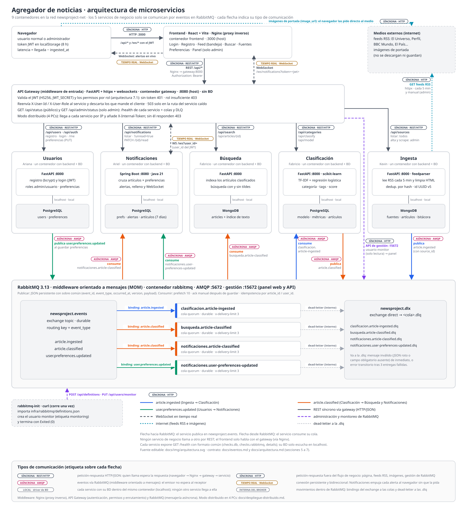
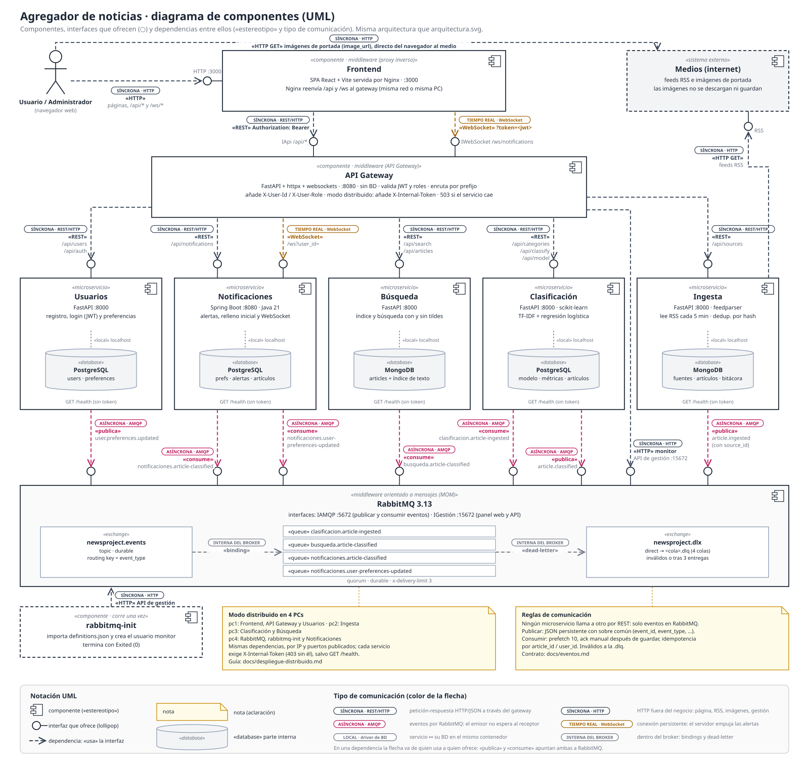
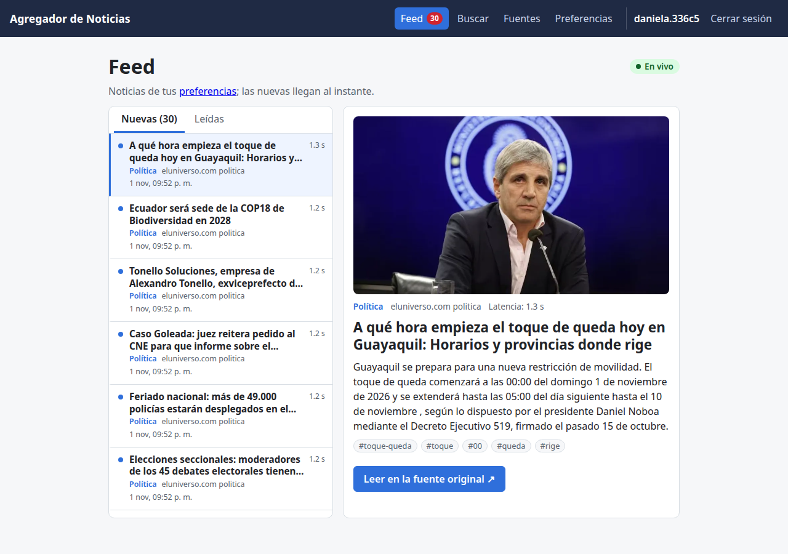
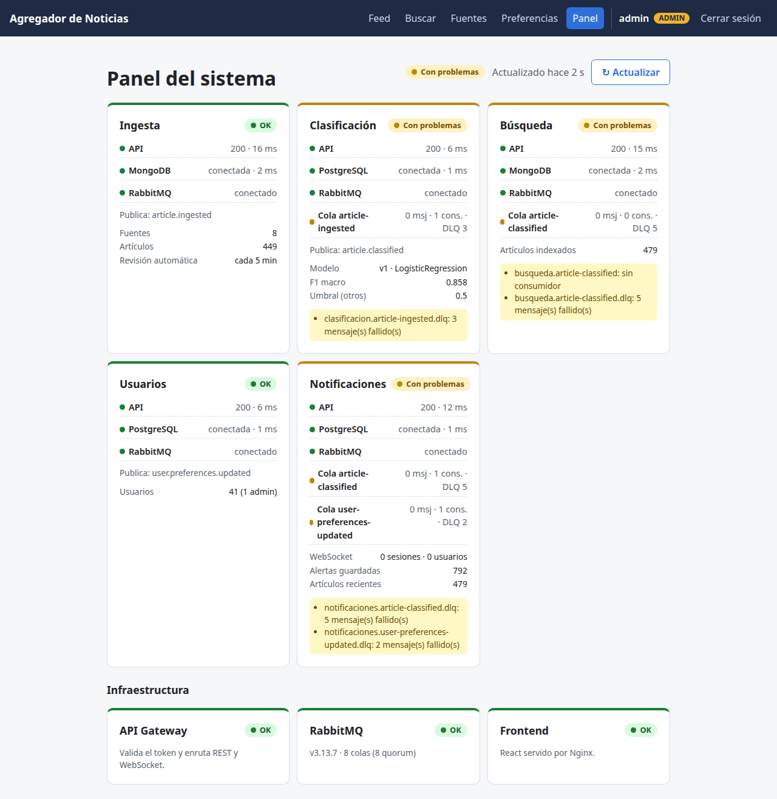
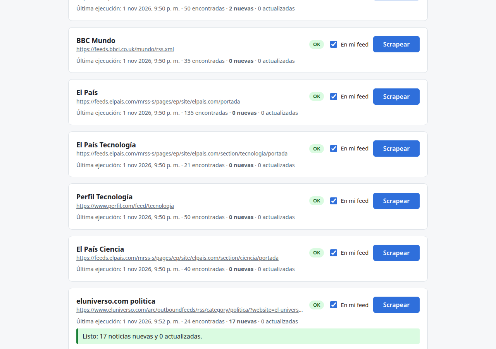
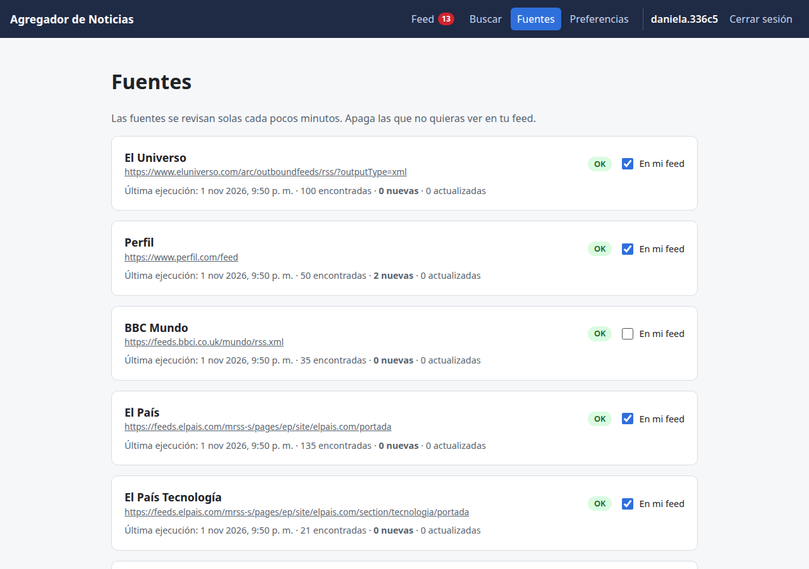

# newsproject — Agregador de Noticias

Agregador de noticias con microservicios (Sistemas Distribuidos, UNL). Ingesta lee fuentes RSS cada 5 minutos, Clasificación asigna a cada noticia una categoría con TF-IDF + regresión logística, Búsqueda las indexa y Notificaciones avisa en tiempo real a cada usuario, por WebSocket, de lo que coincide con sus intereses. Los servicios solo se comunican por eventos en RabbitMQ.

- Arquitectura completa: [`docs/arquitectura.md`](docs/arquitectura.md)
- Contrato de eventos: [`docs/eventos.md`](docs/eventos.md) — **léanlo antes de programar**



*Cada flecha indica su ruta, evento o cola. Fuente editable: [`docs/img/arquitectura.svg`](docs/img/arquitectura.svg).*

Cada flecha indica también su **tipo de comunicación**: síncrona (REST/HTTP), asíncrona (eventos AMQP por RabbitMQ, el middleware de mensajería), en tiempo real (WebSocket) o local (servicio y su BD). La misma arquitectura en notación UML, como diagrama de componentes con interfaces y dependencias:



*Fuente editable: [`docs/img/uml-componentes.svg`](docs/img/uml-componentes.svg). Los dos diagramas se generan con `docs/img/genera_arquitectura.py` y `docs/img/genera_uml.py`; si cambia la arquitectura, se actualizan ambos.*

## Qué hace

- **Cuentas:** registro con correo, contraseña, nombres, apellidos y username; inicio de sesión con JWT. Dos roles: **administrador** (agrega fuentes, las scrapea y ve el panel del sistema) y **usuario**.
- **Feed en vivo:** las noticias que coinciden con las categorías y palabras clave del usuario llegan por WebSocket sin recargar, con su latencia. Al elegir intereses, el feed se llena con las noticias recientes que ya coincidían.
- **Fuentes por usuario:** cada usuario apaga las fuentes que no quiere ver en su feed.
- **Búsqueda** con y sin tildes, por categoría.
- **Panel del sistema** (solo admin): estado de cada microservicio con su base de datos y sus colas.

| Feed (bandeja en dos paneles) | Panel del sistema (admin) |
|---|---|
|  |  |
| **Fuentes del administrador** | **Fuentes de un usuario** |
|  |  |

## Servicios

Cada microservicio de negocio es **un contenedor con su backend y su base de datos dentro**. La BD solo escucha en `localhost`, así ningún otro servicio puede leerla.

| Servicio | Carpeta | Responsable | Tecnología | Base de datos (mismo contenedor) | Publica | Consume |
|---|---|---|---|---|---|---|
| Ingesta | `ingesta/` | Kevin | Python · FastAPI · feedparser | MongoDB | `article.ingested` | — |
| Clasificación | `clasificacion/` | Fabricio | Python · FastAPI · scikit-learn | PostgreSQL | `article.classified` | `article.ingested` |
| Búsqueda | `busqueda/` | Fabricio | Python · FastAPI | MongoDB | — | `article.classified` |
| Usuarios | `usuarios/` | Ariana | Python · FastAPI · bcrypt · PyJWT | PostgreSQL | `user.preferences.updated` | — |
| Notificaciones | `notificaciones/` | Ariel | Java 21 · Spring Boot | PostgreSQL | — | `article.classified`, `user.preferences.updated` |
| API Gateway | `gateway/` | Ariana | Python · FastAPI · httpx · websockets | — | — | — |
| Frontend | `frontend/` | Todos | React · Vite · Nginx | — | — | — |

## Requisitos

- Docker y Docker Compose v2 (`docker compose version`). En Linux, tu usuario debe estar en el grupo `docker`.
- Git

## Cómo levantar todo

```bash
git clone https://github.com/YooneR1209/newsproject.git
cd newsproject
cp .env.example .env          # luego cambia las claves dentro de .env
docker compose up -d --build
```

La primera vez tarda varios minutos porque construye las imágenes. En `.env`, además de las claves de RabbitMQ y de cada base de datos:

| Variable | Para qué sirve |
|---|---|
| `JWT_SECRET` | Firma los tokens de sesión (solo Usuarios y el gateway). Usa 32 o más caracteres aleatorios: `python3 -c "import secrets; print(secrets.token_urlsafe(48))"` |
| `ADMIN_EMAIL`, `ADMIN_PASSWORD`, `ADMIN_USERNAME` | Primer administrador; Usuarios lo crea al arrancar si no existe |
| `RABBITMQ_MONITOR_USER`, `RABBITMQ_MONITOR_PASS` | Usuario de RabbitMQ de solo lectura para el panel del sistema |
| `INGESTA_SCRAPING_INTERVAL_MINUTES` | Cada cuántos minutos Ingesta revisa las fuentes (5) |
| `NOTIFICACIONES_ALERTS_RETENTION_DAYS` | Días que se conservan las alertas (7) |
| `CLASIFICACION_MIN_SCORE` | Confianza mínima; por debajo, la noticia queda en `otros` (0.5) |

Si falta una variable obligatoria, `docker compose` se detiene con un mensaje como `Falta JWT_SECRET en .env (ver .env.example)`.

| Recurso | Dirección |
|---|---|
| Aplicación | http://localhost:3000 |
| API Gateway | http://localhost:8080 (por ejemplo `http://localhost:8080/api/status`) |
| Panel de RabbitMQ | http://localhost:15672 (`RABBITMQ_USER` / `RABBITMQ_PASS` del `.env`) |
| RabbitMQ (AMQP, solo desarrollo) | `localhost:5672` |

## Uso

1. Entra a http://localhost:3000 y crea una cuenta en **Crear cuenta**. Al registrarte eliges tus categorías y palabras clave; al guardar vas al **Feed**, que ya trae las noticias recientes que coinciden.
2. En **Fuentes** apaga las que no quieras ver («En mi feed»). Las fuentes se revisan solas cada 5 minutos y las noticias nuevas llegan al Feed sin recargar.
3. Para administrar, inicia sesión con `ADMIN_EMAIL` / `ADMIN_PASSWORD`. El administrador ve además **Agregar fuente**, **Scrapear** y el **Panel**.

| Página | Usuario | Administrador |
|---|---|---|
| Iniciar sesión · Crear cuenta | ✓ | ✓ |
| Feed: pestañas Nuevas y Leídas, detalle y latencia | ✓ | ✓ |
| Buscar: texto, categoría y detalle | ✓ | ✓ |
| Fuentes: lista con último estado e interruptor «En mi feed» | ✓ | ✓ |
| Fuentes: agregar fuente y «Scrapear» | — | ✓ |
| Preferencias: categorías, palabras clave y notificaciones | ✓ | ✓ |
| Panel del sistema: servicios, BD, colas e infraestructura | — | ✓ |

Para la demo de la sección 11 de `docs/arquitectura.md`, empieza desde cero (`docker compose down -v && docker compose up -d --build`) y, como administrador, agrega una fuente nueva y scrapéala: sus noticias son nuevas y llegan en vivo al feed del usuario.

## Verificar que todo está bien

```bash
docker compose ps -a
```

- `ingesta`, `clasificacion`, `busqueda`, `usuarios`, `notificaciones`, `gateway` y `rabbitmq` deben aparecer como `healthy`.
- `newsproject-rabbitmq-init` debe aparecer como `Exited (0)`: corre una vez para cargar las colas y crear el usuario de monitoreo.

```bash
docker logs newsproject-rabbitmq-init                                  # "Definiciones importadas" y "Usuario de monitoreo listo"
docker exec newsproject-rabbitmq rabbitmqctl list_queues name type     # 8 colas quorum
curl -s localhost:8080/api/status                                      # "status": "ok" en los 5 servicios
```

O, como administrador, abre **Panel** en la aplicación: cada servicio debe estar en verde.

### Pruebas automáticas

`verificacion/scripts/` tiene las pruebas del sistema completo: API por el gateway, eventos en RabbitMQ, la app con Playwright y tolerancia a fallos. Cada ejecución guarda su informe, logs y capturas en `verificacion/ejecuciones/<fecha_hora>/` (no se versiona). Instrucciones en [`verificacion/README.md`](verificacion/README.md).

### Entrar a la base de datos de un servicio

Las BD no publican puertos; se entra desde su contenedor:

```bash
docker exec -it newsproject-clasificacion psql -U <CLASIFICACION_DB_USER> clasificacion
docker exec -it newsproject-ingesta mongosh -u <INGESTA_DB_USER> -p <INGESTA_DB_PASS>
```

## Modo distribuido en 4 PCs (opcional)

Además del modo de una PC descrito arriba, el sistema se puede repartir en **4 PCs Linux** conectadas por un switch (LAN) o por Tailscale. Es opcional: no cambia `docker-compose.yml`, `.env` ni nada de lo anterior, y los dos modos usan contenedores y volúmenes distintos.

| | Una PC | Distribuido |
|---|---|---|
| Se levanta con | `docker compose up -d --build` | `deploy/levantar.sh <switch\|tailscale>` en cada PC |
| Compose y variables | `docker-compose.yml` · `.env` | `docker-compose.distribuido.yml` · `.env.distribuido`, `.env.switch` o `.env.tailscale`, `.env.pc` |
| Los servicios se encuentran por | Nombres de la red interna de Docker | IP de cada PC y puertos publicados |
| Los servicios están protegidos por | La red interna (no se publican) | Un token interno: sin el gateway responden `403` |
| La app | `http://localhost:3000` | `http://<IP de pc1>:3000` |

| PC | Qué corre | Puertos |
|---|---|---|
| pc1 | gateway, frontend, usuarios | 8080, 3000, 8004 |
| pc2 | ingesta | 8001 |
| pc3 | clasificacion, busqueda | 8002, 8003 |
| pc4 | RabbitMQ (+ `rabbitmq-init`), notificaciones | 5672, 15672, 8005 |

```bash
cp .env.distribuido.example .env.distribuido   # claves: el mismo archivo en las 4 PCs
cp .env.switch.example .env.switch             # IPs de las 4 PCs (o .env.tailscale)
cp .env.pc.example .env.pc                     # PC=pc1, pc2, pc3 o pc4: distinto en cada PC
deploy/levantar.sh switch                      # en cada PC, empezando por pc4
deploy/revisar_red.sh switch                   # tabla OK/FALLA de red, puertos y /health
```

Guía completa, con los pasos para switch y Tailscale, el orden de pruebas y los problemas comunes: [`docs/despliegue-distribuido.md`](docs/despliegue-distribuido.md).

## Reglas para desarrollar un servicio

1. El backend lee su configuración del entorno (`DATABASE_URL`, `RABBITMQ_URL` o `SPRING_*` en Notificaciones); nunca credenciales en el código.
2. Reintenta la conexión a la BD y a RabbitMQ al arrancar, con espera creciente.
3. `GET /health` responde 200 solo si la BD y RabbitMQ están conectados, con el formato común (`checks.db`, `checks.rabbitmq`, `details`) que lee el panel del sistema.
4. Sigue `docs/eventos.md`: sobre común, publicación persistente, prefetch 10, `ack` manual después de guardar, idempotencia por `article_id` o `user_id` y mensajes inválidos a la `.dlq`.
5. No declares colas ni exchanges en el código (los crea `rabbitmq-init`).
6. Ningún servicio llama a otro por REST; solo publica o consume eventos. El gateway valida el JWT y pasa al servicio `X-User-Id` y `X-User-Role`.

Para probar un servicio fuera de Docker (por ejemplo con `uvicorn --reload`), levanta solo el broker con `docker compose up -d rabbitmq rabbitmq-init`; el puerto 5672 se publica desde `docker-compose.override.yml`.

## Dataset de Clasificación

El modelo de Clasificación (TF-IDF + regresión logística, en `clasificacion/model/`) se entrenó con noticias etiquetadas por la **sección** del medio: todo lo del feed de deportes es `deportes`.

- `clasificacion/data/feeds.csv`: feeds por sección, con su categoría y país (`EC`, `ES`, `AR`).
- `clasificacion/tools/collect_dataset.py`: lee los feeds y agrega las noticias nuevas sin duplicar.
- `clasificacion/tools/train.py`: entrena el modelo y guarda sus métricas (`GET /api/model`).
- `.github/workflows/dataset.yml`: GitHub Actions ejecuta el recolector cada hora y guarda `dataset.csv` en la rama `dataset` (no en `main`).

```bash
# Traer el dataset acumulado
git fetch origin dataset
git show origin/dataset:dataset.csv > clasificacion/data/dataset.csv

# Probar los feeds o armar el conjunto de prueba (revisión manual)
pip install -r clasificacion/tools/requirements.txt
python clasificacion/tools/collect_dataset.py --check
python clasificacion/tools/collect_dataset.py --sample-test 140 --local-share 0.5
```

Ingesta arma el texto de cada noticia con las mismas funciones que el recolector (`normalize_url`, `clean_html`, `entry_text`), para que el modelo reciba en producción textos iguales a los de entrenamiento. Detalle en `docs/arquitectura.md`, sección 3.2.

## Flujo de trabajo con Git

- Cada integrante trabaja en su rama: `kevin-dev`, `fabricio-dev`, `ariana-dev`, `ariel-dev`.
- Antes de empezar, trae lo último de `main`: `git checkout <tu-rama> && git merge main`.
- Los cambios llegan a `main` por pull request revisado por otro integrante.
- Antes de cada merge, `docker compose up -d --build` debe levantar el sistema completo.
- Los contratos de eventos y de REST (`docs/eventos.md`, `docs/arquitectura.md` secciones 5 a 7) solo cambian por pull request aprobado por los cuatro.
- Un solo release al final: `v1.0`. No se crean releases intermedios.

## Problemas comunes

**`docker compose` dice «Falta JWT_SECRET en .env» (o `ADMIN_PASSWORD`, `RABBITMQ_MONITOR_PASS`).**
Tu `.env` es de una versión anterior. Copia las variables nuevas desde `.env.example`.

**Las colas no son de tipo quorum o `rabbitmq-init` falla.**
Una cola existente no cambia de tipo. Si ya habías levantado una versión anterior, borra los volúmenes (se pierden los datos locales):

```bash
docker compose down -v
docker compose up -d --build
```

**El panel del sistema muestra un servicio «Con problemas» por su DLQ.**
Hay mensajes que no se pudieron procesar (por ejemplo, los de la prueba del mensaje envenenado). Revísalos en el panel de RabbitMQ y, si no sirven, vacía la cola: `docker exec newsproject-rabbitmq rabbitmqctl purge_queue <cola>.dlq`.

**No puedo entrar con una cuenta antigua.**
Las cuentas de antes del registro con contraseña no tienen clave. Crea una cuenta nueva o empieza desde cero con `docker compose down -v`.

**Un servicio queda en `unhealthy`.**
Revisa sus logs: `docker compose logs -f <servicio>`. En los logs aparecen los dos procesos (`db` y `api`).

**Error de puerto ocupado (3000, 8080, 5672, 15672).**
Detén el programa que usa ese puerto (por ejemplo, otro RabbitMQ) o cambia el puerto de la izquierda en `docker-compose.yml` (por ejemplo `"8081:8000"`).

**RabbitMQ aparece como no saludable justo después de arrancar.**
Espera 20 a 30 segundos la primera vez y vuelve a ejecutar `docker compose ps -a`.

## Comandos útiles

```bash
docker compose up -d --build        # construir y levantar todo
docker compose logs -f <servicio>   # ver logs
docker compose stop <servicio>      # detener un servicio (prueba de tolerancia a fallos)
docker compose start <servicio>     # volver a iniciarlo
docker compose down                 # detener (conserva datos)
docker compose down -v              # detener y borrar datos (usuarios, fuentes, alertas, colas)
```
